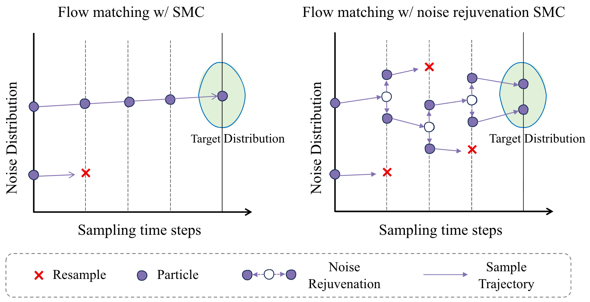

<h2 align="center">Test-Time Scaling of Text-to-Image Flow Matching Models<br>with Noise-Rejuvenated Sequential Monte Carlo</h2>

<p align="center">
  <a>arXiv (tbu)</a>
  <!-- Add the arXiv URL to the link above when available. -->
</p>

> **NR-SMC** guides pretrained text-to-image flow matching models toward higher-reward images by maintaining multiple sampling trajectories. It resamples promising particles and refreshes their source noise so that duplicated particles can explore different paths, without additional training or reward gradients.

## Overview

Flow matching models generate images through deterministic ODE dynamics. Applying SMC resampling directly can duplicate particles that then follow identical trajectories, limiting further exploration.

NR-SMC introduces **noise rejuvenation at resampling steps**: it constructs a new intermediate latent from a particle's current endpoint estimate and freshly sampled source noise. Particles then continue under the flow matching solver.

<p align="center">
  
</p>

*Standard SMC can collapse onto identical trajectories under deterministic flow matching (left). Noise rejuvenation enables resampled particles to explore alternative trajectories (right).*

- **Training-free, gradient-free guidance:** guide pretrained models using an external reward such as ImageReward.
- **Particle exploration:** noise rejuvenation helps particles explore distinct trajectories after resampling.
- **Multiple backbones:** Stable Diffusion 3, FLUX.1-dev, and Z-Image.
- **Compositional evaluation:** GenEval and the color, shape, and texture subsets of T2I-CompBench.

## Setup

### 1. Create an environment

```bash
conda create -n nr-smc python=3.11
conda activate nr-smc

git clone https://github.com/shermanlian/NR-SMC.git
cd NR-SMC
```

Install a CUDA-enabled [PyTorch](https://pytorch.org/get-started/locally/) build compatible with your GPU and driver. The current generation environment uses the following core versions; a fresh installation on other hardware has not yet been validated.

| Component | Reference version |
| :--- | :--- |
| Python | 3.11 |
| PyTorch / torchvision | 2.12.1+cu130 / 0.27.1+cu130 |
| Diffusers | 0.39.0 |
| Transformers | 4.57.1 |
| Accelerate | 1.14.0 |
| ImageReward | 1.5 |
| HPSv2 package | 1.2.0 |

After installing PyTorch and torchvision, install the generation and reward dependencies:

```bash
pip install diffusers==0.39.0 transformers==4.57.1 accelerate==1.14.0 \
  image-reward==1.5 hpsv2==1.2.0 \
  numpy pillow matplotlib tqdm sentencepiece protobuf google-genai
pip install git+https://github.com/openai/CLIP.git
```

### 2. Prepare model access

The code loads pretrained backbones from Hugging Face:

| Argument | Model |
| :--- | :--- |
| `--model_name sd3` | `stabilityai/stable-diffusion-3-medium-diffusers` |
| `--model_name flux` | `black-forest-labs/FLUX.1-dev` |
| `--model_name zimage` | `Tongyi-MAI/Z-Image` |

Obtain access to the selected model and authenticate with Hugging Face where required. Model and reward weights are downloaded on first use. Follow the respective model licenses.

GenEval and T2I-CompBench have additional evaluation dependencies; see [Evaluation](#evaluation). We recommend keeping the GenEval environment separate from the generation environment.

## Generation

### Quick start: SD3

Run a small example using the first two GenEval prompts:

```bash
python launch_geneval_runs.py \
  --model_name sd3 \
  --use_smc --adaptive_resampling --rejuvenation --look_ahead \
  --num_particles 4 --num_inference_steps 50 \
  --lmbda 10.0 \
  --resample_frequency 5 --resample_t_start 5 --resample_t_end 35 \
  --guidance_reward_fn ImageReward --metrics_to_compute ImageReward \
  --prompt_path prompt_files/geneval_metadata.jsonl \
  --seed 0 --max_prompts 2 \
  --run_root runs --experiment_name sd3_geneval_demo
```

Each prompt produces four final particle images. Outputs, per-prompt metadata, and compute summaries are saved under `runs/sd3_geneval_demo/`.

### Full GenEval generation

Use the same configuration, remove `--max_prompts 2`, and choose a new experiment name, such as `sd3_geneval_ours_seed0`. The complete GenEval set contains 553 prompts.

To run **FLUX.1-dev** or **Z-Image**, change `--model_name` to `flux` or `zimage`, respectively, and use a distinct experiment name. For an existing run, `--resume` skips completed prompts. Exact continuation of the global random stream requires starting the run with `--checkpoint_global_rng` and using that flag again when resuming.

### T2I-CompBench generation

Build the combined color, shape, and texture prompt metadata:

```bash
python prepare_t2icomp_metadata.py
```

Use the generation command above with these changes:

```bash
--benchmark t2icomp \
--prompt_path prompt_files/t2i/t2icompbench_attr_metadata.jsonl \
--experiment_name sd3_t2icomp_ours_seed0
```

Remove the demo's `--max_prompts` limit for the complete set of 900 prompts.

### Configuration

| Argument | Paper setting | Description |
| :--- | :--- | :--- |
| `--num_particles` | `4` | Number of particle trajectories per prompt |
| `--num_inference_steps` | `50` | Number of sampling steps |
| `--lmbda` | `10.0` | Strength of reward guidance |
| `--resample_frequency` | `5` | Interval between resampling checks |
| `--resample_t_start` / `--resample_t_end` | `5` / `35` | Resampling window in sampling-step indices |
| `--adaptive_resampling` | Enabled | Use the effective sample size criterion |
| `--rejuvenation` | Enabled | Enable noise rejuvenation |
| `--look_ahead` | Enabled | Enable look-ahead refinement |
| `--guidance_reward_fn` | `ImageReward` | Reward used for particle weighting |

`--naive_noise` enables direct latent-noise perturbation and is not part of the default NR-SMC command. Use `--help` for the complete argument list.

## Evaluation

**Generation and evaluation are separate steps.** ImageReward guides particle sampling. GenEval, HPS, and BVQA provide additional evaluation signals.

For the main experiments, evaluate **all final particles** and aggregate over particles and prompts.

### GenEval

Install the official [GenEval](https://github.com/djghosh13/geneval) repository, its detector checkpoints, and its dependencies according to the upstream instructions. Use the Python executable from that evaluation environment:

```bash
export GENEVAL_ROOT=/path/to/geneval
export GENEVAL_PYTHON=/path/to/geneval-env/bin/python

"$GENEVAL_PYTHON" evaluate_geneval_combined.py \
  runs/sd3_geneval_ours_seed0 \
  --geneval_root "$GENEVAL_ROOT"
```

The evaluation directory contains:

| Output | Meaning |
| :--- | :--- |
| `evaluation/geneval_all_particles_summary.json` | Main all-particle GenEval summary, including task-wise scores |
| `evaluation/geneval_selected_top1_summary.json` | GenEval summary for the ImageReward-selected particle per prompt |

Corresponding per-image JSONL files and readable text summaries are also saved.

### ImageReward and human preference scores

Score the saved images in the generation environment:

```bash
python score_saved_images.py runs/sd3_geneval_ours_seed0 \
  --metrics 'ImageReward#HumanPreference' --resume
```

Results are written to `offline_metrics.json`. Use `global_all_particles` for all-image statistics and `selected_top1` for the sample-selection protocol. The `HumanPreference` implementation currently requests the HPSv2.1 checkpoint through the HPSv2 package.

### T2I-CompBench BVQA

Set up the official [T2I-CompBench](https://github.com/Karine-Huang/T2I-CompBench) BLIP-VQA evaluator and checkpoints. The wrapper expects the evaluator under `external/T2I-CompBench-1b709499/`; third-party environments and model weights are not included in this repository.

```bash
export ENV_PREFIX=/path/to/inference-env
bash run_t2icomp_bvqa runs/sd3_t2icomp_ours_seed0
```

The wrapper prepares evaluation views for color, shape, and texture, runs the upstream evaluator, and writes `evaluation/t2icomp_bvqa_summary.json` with all-particle and selected-top-1 summaries. Evaluator dependencies must be available in the selected environment or the wrapper's `external/t2i_eval_pydeps/` search path.

## Citation

If you find this work useful, please cite:

```bibtex
@article{
tbu
}
```

## Acknowledgements

Our implementation builds on the [FK-Diffusion-Steering](https://github.com/zacharyhorvitz/FK-Diffusion-Steering) framework. We sincerely thank its authors for making their framework and code publicly available. We also thank the teams behind Stable Diffusion 3, FLUX.1-dev, and Z-Image for releasing the pretrained models used in this work.
